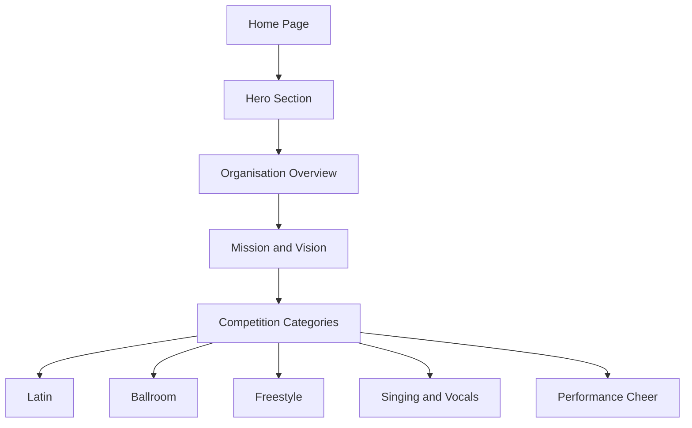

# Legends Are Made Dance Series Website

## Student Information

**Student Name:** Moeketsi Nteo  
**Student Number:** st10539789

## Project Overview

Legends Are Made Dance Series is a dance and entertainment competition that provides performers with an opportunity to showcase their talents. The organisation offers different performance categories, including Latin, Ballroom, Freestyle, Singing/Vocals and Performance Cheer.

The purpose of this project is to develop a professional website that provides a central platform for competition information, competitor applications, event photographs and contact information.

The website was developed using HTML5, CSS3 and JavaScript. It includes responsive features for desktop, tablet and mobile devices, as well as interactive elements that improve the user experience.

## Website Goals and Objectives

- Create a professional online presence for Legends Are Made Dance Series.
- Make competition information easier to access.
- Provide competitors with a simple online application process.
- Showcase competition photographs and event highlights.
- Provide clear contact and social media information.
- Create a responsive website for desktop, tablet and mobile devices.
- Use consistent colours, typography and layouts throughout the website.
- Improve user interaction through JavaScript functionality.

## Key Features and Functionality

- **Home** – Organisation overview, mission, vision and competition categories.
- **Competitions** – Competition information, categories, rules and an Apply Now option.
- **Apply** – Multi-step application form that allows competitors to enter their details, review their information, edit their application and confirm it.
- **Gallery** – Competition photographs and event highlights.
- **Contact** – Contact details, social media links and an enquiry form with validation and feedback.
- **Responsive Design** – The website adapts to different screen sizes.
- **Mobile Navigation** – A hamburger menu is used on tablet and mobile screen sizes.
- **Category Hover Effects** – Additional information appears when hovering over competition categories.
- **Active Navigation** – The current page is highlighted in the navigation menu.
- **Font Awesome Icons** – Icons are used for contact and social media information.
- **Form Validation** – JavaScript checks that required application and enquiry fields are completed correctly.
- **Application Review** – Competitors can review the information they entered before confirming their application.
- **Edit Application** – Competitors can return to the application form to correct their details.
- **Application Confirmation** – A confirmation screen is displayed after the competitor confirms the application.
- **Contact Form Feedback** – Feedback messages inform users whether the enquiry details have passed validation.
- **Form Reset** – The contact form fields are cleared after valid details have been checked.
- **Consistent Visual Design** – A black, white and red colour scheme is used throughout the website.

## Website Pages

The website consists of five main pages:

- Home
- Competitions
- Apply
- Gallery
- Contact

## Design

The website uses a black, white and red colour scheme to create a strong and modern visual identity suitable for the dance competition theme.

CSS was used to style the navigation, headings, buttons, competition category cards, forms, gallery, contact section and page layouts.

The competition category cards include hover effects that display additional information about each category. The website also uses consistent navigation and footer layouts across its pages.

## JavaScript Functionality

JavaScript was added to make the website more interactive, particularly the Apply and Contact pages. The JavaScript code is contained in `script.js`.

### Apply Page

The Apply page was improved by introducing a multi-step application process instead of displaying the entire process on a single screen.

The process includes:

- **Application Form:** Competitors enter their personal and competition details.
- **Validation:** JavaScript checks whether the required fields have been completed correctly.
- **Review Screen:** The entered information is displayed so competitors can check their details.
- **Edit Option:** Competitors can return to the form and make corrections before confirming.
- **Confirmation Screen:** A confirmation screen is displayed after the competitor confirms the application.
- **New Application:** The form can be used again to start another application.

This makes the application process easier to follow and gives competitors an opportunity to check their information before confirmation.

### Apply Page Flowchart

The following flowchart illustrates the application process and its main decision points.

*Note: The flowchart represents the website's front-end application process. The confirmation screen does not, by itself, mean that the application has been submitted to a server or stored in a database.*

### Contact Page

JavaScript was also added to the Contact page to improve form validation and user feedback.

- Checks that the required fields are completed correctly.
- Displays a validation message when the details are incomplete or invalid.
- Displays feedback after the details pass validation.
- Clears the form fields after valid details have been checked.

The contact form currently provides front-end validation and feedback. An email or server-side submission service is not connected, so the enquiry is not automatically sent.

## Home Page Content Structure

The Home page introduces the organisation and provides an overview of its purpose and competition categories.

The About section is part of the Home page rather than a separate page. It introduces Legends Are Made Dance Series, followed by the organisation's mission and vision and an overview of the available competition categories.

The following diagram shows how the main content sections are organised on the Home page.

This is a content structure diagram rather than a process flowchart because it shows the organisation of the page content.

## Responsive Design

The website was developed to be responsive across different screen sizes and devices. The layout, navigation, images, forms and content adjust to provide a consistent user experience on desktop, tablet and mobile devices.

### Desktop

The following screenshots show all website pages on a desktop/laptop screen.

#### Home

#### Competitions

#### Apply

#### Gallery

#### Contact

### Tablet

The following screenshots show all website pages on a tablet device.

#### Home

#### Competitions

#### Apply

#### Gallery

#### Contact

### Mobile

The following screenshots show all website pages on a mobile device.

#### Home

#### Competitions

#### Apply

#### Gallery

#### Contact

## Timeline and Milestones

| Stage | Milestone |
|---|---|
| Part 1 | Organisation selection, proposal, research, requirements and sitemap |
| Part 2 | Wireframes, visual design and website development using HTML and CSS |
| Part 3 | JavaScript functionality, testing, improvements, finalisation and deployment |

The overall project is expected to take approximately **6–8 weeks**.

## Project Status

The website has been developed using HTML5, CSS3 and JavaScript. The current implementation includes responsive layouts, navigation, category hover effects, an interactive application process, form validation and user feedback.

The Apply page includes a review and confirmation process, while the Contact page provides front-end validation. Further testing and improvements can be completed as part of the final stage of the project.

## References

The following sources were consulted during the development of the Legends Are Made Dance Series website.

- Mozilla Developer Network (MDN) (n.d.) *HTML: HyperText Markup Language*. Available at: https://developer.mozilla.org/en-US/docs/Web/HTML
- Mozilla Developer Network (MDN) (n.d.) *CSS: Cascading Style Sheets*. Available at: https://developer.mozilla.org/en-US/docs/Web/CSS
- Mozilla Developer Network (MDN) (n.d.) *JavaScript*. Available at: https://developer.mozilla.org/en-US/docs/Web/JavaScript
- W3Schools (n.d.) *HTML Tutorial*. Available at: https://www.w3schools.com/html/
- W3Schools (n.d.) *CSS Tutorial*. Available at: https://www.w3schools.com/css/
- W3Schools (n.d.) *JavaScript Tutorial*. Available at: https://www.w3schools.com/js/

